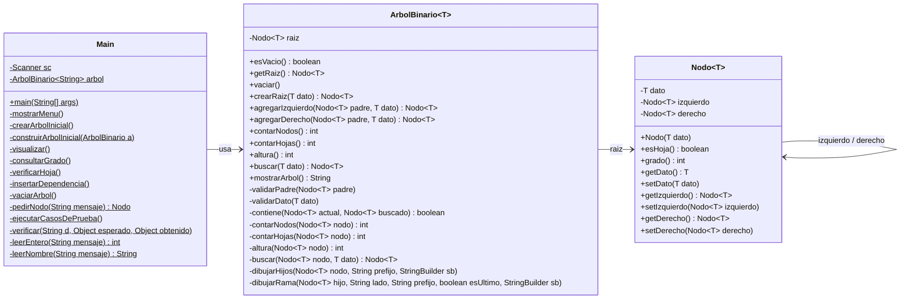
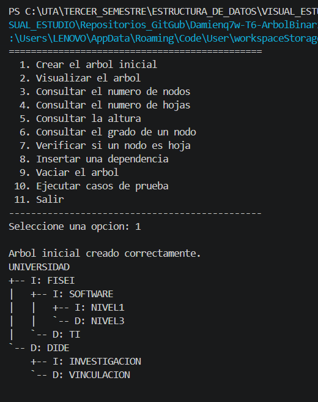
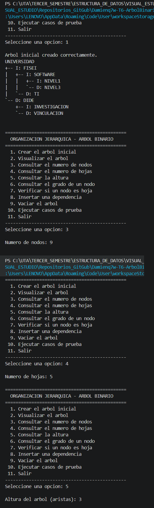
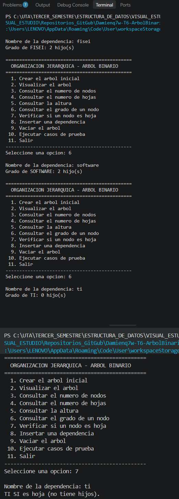
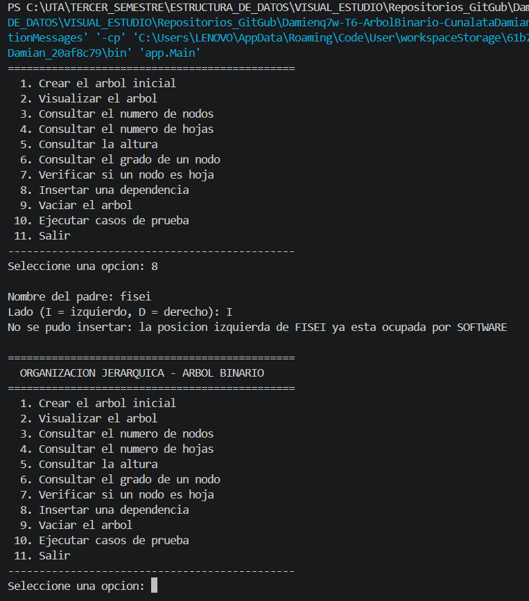
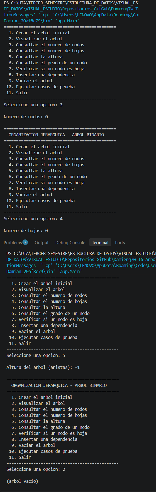
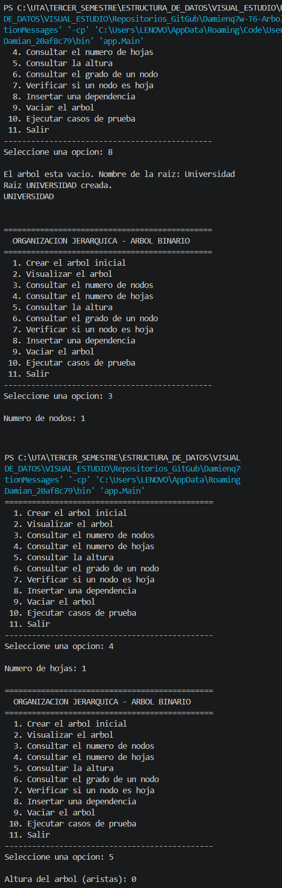
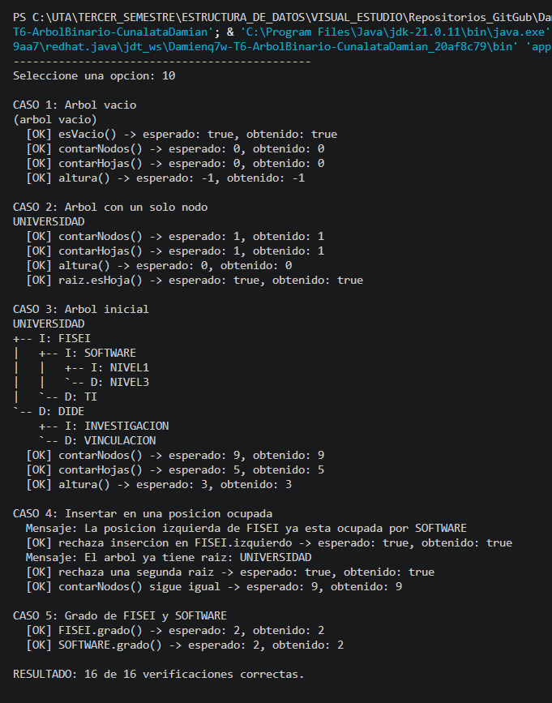

# T6 · Árbol Binario en Java

### Sistema de organización jerárquica de departamentos universitarios

| | |
|---|---|
| **Asignatura** | Estructura de Datos |
| **Nivel** | Tercer semestre · Ingeniería de Software |
| **Universidad** | Universidad Técnica de Ambato (UTA) |
| **Estudiante** | Cunalata Mendoza Damian Alexander |
| **Modalidad** | Individual · práctica de programación |
| **Herramientas** | Java 17 · Visual Studio Code · Git y GitHub |

---

## Contenido

1. [Problema](#1-problema)
2. [Objetivo](#2-objetivo)
3. [Estructura del árbol](#3-estructura-del-árbol)
4. [Conceptos aplicados](#4-conceptos-aplicados)
5. [Arquitectura del proyecto](#5-arquitectura-del-proyecto)
6. [Clases y operaciones](#6-clases-y-operaciones)
7. [Cómo funciona la recursividad](#7-cómo-funciona-la-recursividad)
8. [Compilación y ejecución](#8-compilación-y-ejecución)
9. [Uso del menú](#9-uso-del-menú)
10. [Casos de prueba y resultados](#10-casos-de-prueba-y-resultados)
11. [Capturas de ejecución](#11-capturas-de-ejecución)
12. [Decisiones de diseño](#12-decisiones-de-diseño)
13. [Restricciones cumplidas](#13-restricciones-cumplidas)

---

## 1. Problema

La Universidad necesita representar cómo se organizan sus dependencias académicas. Cada dependencia pertenece a **una sola** dependencia superior y puede tener **como máximo dos** dependencias a su cargo.

Si estos datos se guardan en una lista, quedan uno detrás de otro y se pierde la información de **quién depende de quién**. Por eso se usa un **árbol binario**: cada nodo guarda el nombre de una dependencia y tiene dos enlaces, uno al hijo izquierdo y otro al hijo derecho. La dependencia principal, `UNIVERSIDAD`, es la raíz y no tiene padre.

## 2. Objetivo

Implementar un árbol binario con programación orientada a objetos en Java que permita **construir** la estructura de dependencias, **visualizarla** en consola y **analizarla**: contar nodos y hojas, calcular la altura, consultar el grado de un nodo y verificar si un nodo es hoja. Las operaciones de conteo y altura se resuelven con **recursividad**.

## 3. Estructura del árbol

```
                    UNIVERSIDAD                      nivel 0
                   /           \
               FISEI             DIDE                nivel 1
              /     \           /     \
        SOFTWARE     TI   INVESTIGACION  VINCULACION nivel 2
         /     \
     NIVEL1   NIVEL3                                 nivel 3
```

| Medida | Valor | Detalle |
|---|:---:|---|
| Raíz | `UNIVERSIDAD` | único nodo sin padre |
| Nodos | **9** | todas las dependencias |
| Hojas | **5** | `TI`, `INVESTIGACION`, `VINCULACION`, `NIVEL1`, `NIVEL3` |
| Nodos internos | **4** | `UNIVERSIDAD`, `FISEI`, `DIDE`, `SOFTWARE` |
| Altura | **3** aristas | camino más largo: `UNIVERSIDAD → FISEI → SOFTWARE → NIVEL1` |
| Grado de `FISEI` | **2** | hijos: `SOFTWARE` y `TI` |
| Grado de `SOFTWARE` | **2** | hijos: `NIVEL1` y `NIVEL3` |

> En el enunciado el nodo aparece abreviado como `INVEST.`; en el programa se usa el nombre completo `INVESTIGACION`. El código no usa tildes, por eso se escribe `VINCULACION`.

## 4. Conceptos aplicados

| Concepto | Significado | En este árbol |
|---|---|---|
| **Raíz** | nodo que no tiene padre | `UNIVERSIDAD` |
| **Hoja** | nodo que no tiene hijos | `TI`, `NIVEL1`, … |
| **Grado** | cantidad de hijos de un nodo (en un árbol binario: 0, 1 o 2) | `FISEI` → 2, `TI` → 0 |
| **Nivel** | distancia de un nodo a la raíz | `SOFTWARE` está en el nivel 2 |
| **Altura** | camino más largo de la raíz a una hoja, contado en **aristas** | 3 |
| **Subárbol** | un nodo con todos sus descendientes | `FISEI` con `SOFTWARE`, `TI`, `NIVEL1`, `NIVEL3` |

**Convención de altura usada:** árbol vacío = **-1**, árbol de un solo nodo = **0**. Así la altura cuenta enlaces y no nodos.

## 5. Arquitectura del proyecto

El código está separado en **tres capas**. Cada capa solo usa a la que tiene debajo:

```
  app (Main)  ───usa───▶  negocio (ArbolBinario)  ───usa───▶  modelo (Nodo)
  menú y consola           reglas y operaciones                dato + enlaces
```

### Diagrama de clases



### Organización de carpetas

```
T6-ArbolBinario-CunalataDamian/
├── src/
│   ├── modelo/
│   │   └── Nodo.java            → dato + enlaces izquierdo/derecho, esHoja(), grado()
│   ├── negocio/
│   │   └── ArbolBinario.java    → reglas de inserción y operaciones recursivas
│   └── app/
│       └── Main.java            → menú con Scanner y casos de prueba
├── doc/
│   └── T6_ArbolBinario_Cunalata.pdf → documento del informe de la tarea
├── img/                         → capturas de ejecución
├── .gitignore                   → excluye bin/ y archivos .class
└── README.md
```

## 6. Clases y operaciones

### `modelo.Nodo<T>`

Es la pieza básica del árbol. Es **genérica** (`<T>`), así que puede guardar cualquier tipo de dato; en este proyecto guarda `String`.

| Miembro | Descripción |
|---|---|
| `dato` | información que guarda el nodo (nombre de la dependencia) |
| `izquierdo`, `derecho` | enlaces a los hijos; si valen `null`, ese hijo no existe |
| `esHoja()` | devuelve `true` si los dos enlaces son `null` |
| `grado()` | cuenta los enlaces que no son `null`: 0, 1 o 2 |
| getters y setters | acceso controlado a los atributos `private` |

### `negocio.ArbolBinario<T>`

Guarda la raíz y aplica las reglas del árbol.

| Operación | Tipo | Descripción |
|---|---|---|
| `esVacio()` | consulta | `true` si no hay raíz |
| `getRaiz()` | consulta | devuelve el nodo raíz |
| `vaciar()` | utilidad | deja el árbol sin nodos |
| `crearRaiz(dato)` | inserción | crea la raíz; se rechaza si ya existe una |
| `agregarIzquierdo(padre, dato)` | inserción | cuelga un hijo a la izquierda; se rechaza si la posición está ocupada |
| `agregarDerecho(padre, dato)` | inserción | lo mismo del lado derecho |
| `contarNodos()` | **recursiva** | número total de nodos |
| `contarHojas()` | **recursiva** | número de nodos sin hijos |
| `altura()` | **recursiva** | camino más largo de la raíz a una hoja, en aristas |
| `buscar(dato)` | recursiva | localiza un nodo por su nombre (lo usa el menú) |
| `mostrarArbol()` | visualización | devuelve el dibujo del árbol para imprimirlo en consola |

**Reglas que valida la inserción:**

| Situación | Respuesta |
|---|---|
| Crear una segunda raíz | `IllegalStateException`: *El arbol ya tiene raiz* |
| Insertar donde ya hay un hijo | `IllegalStateException`: *La posicion ... ya esta ocupada por ...* |
| Insertar con el árbol vacío | `IllegalStateException`: *primero cree la raiz* |
| Padre `null` o de otro árbol | `IllegalArgumentException` |
| Dato `null` | `IllegalArgumentException` |

`IllegalArgumentException` indica que **el dato recibido** está mal; `IllegalStateException` indica que **el estado del árbol** no permite la operación. En ningún caso el árbol queda modificado.

### `app.Main`

Contiene el menú interactivo con `Scanner`, construye el árbol inicial y ejecuta los casos de prueba. Las reglas del árbol viven en `ArbolBinario`; `Main` solo agrega validaciones de la interfaz: revisa si la posición está ocupada antes de pedir el nombre e impide registrar dos dependencias con el mismo nombre.

## 7. Cómo funciona la recursividad

Cada operación recursiva tiene **dos métodos**:

- uno **público sin parámetros** (`contarNodos()`), que es el que se llama desde `Main` y simplemente empieza en la raíz;
- uno **privado que recibe un nodo** (`contarNodos(Nodo)`), que se llama a sí mismo con los hijos, cada vez con un subárbol más pequeño, hasta llegar a `null` (**caso base**).

| Operación | Caso base | Paso recursivo |
|---|---|---|
| `contarNodos(n)` | `n == null` → `0` | `1 + contarNodos(izq) + contarNodos(der)` |
| `contarHojas(n)` | `n == null` → `0` · `n` es hoja → `1` | `contarHojas(izq) + contarHojas(der)` |
| `altura(n)` | `n == null` → `-1` | `1 + max(altura(izq), altura(der))` |

**¿Por qué la altura de `null` es -1?** Porque así una hoja da `1 + max(-1, -1) = 0`: una hoja no tiene aristas hacia abajo.

### Traza de `altura()` sobre el árbol inicial

```
altura(NIVEL1)      = 1 + max(-1, -1) = 0
altura(NIVEL3)      = 1 + max(-1, -1) = 0
altura(SOFTWARE)    = 1 + max( 0,  0) = 1
altura(TI)          = 1 + max(-1, -1) = 0
altura(FISEI)       = 1 + max( 1,  0) = 2
altura(INVESTIGACION), altura(VINCULACION) = 0
altura(DIDE)        = 1 + max( 0,  0) = 1
altura(UNIVERSIDAD) = 1 + max( 2,  1) = 3   ✔
```

### Traza de `contarNodos()`

```
contarNodos(SOFTWARE)    = 1 + 1 + 1 = 3
contarNodos(FISEI)       = 1 + 3 + 1 = 5
contarNodos(DIDE)        = 1 + 1 + 1 = 3
contarNodos(UNIVERSIDAD) = 1 + 5 + 3 = 9   ✔
```

### Complejidad

Con *n* = número de nodos y *h* = altura del árbol:

| Operación | Tiempo | Memoria (pila de recursión) | Motivo |
|---|:---:|:---:|---|
| `esVacio()`, `crearRaiz()` | O(1) | O(1) | solo revisa o asigna la raíz |
| `contarNodos()`, `contarHojas()`, `altura()` | O(n) | O(h) | visitan cada nodo una vez |
| `buscar(dato)` | O(n) | O(h) | en el peor caso recorre todo el árbol |
| `agregarIzquierdo()`, `agregarDerecho()` | O(n) | O(h) | `contiene()` comprueba que el padre pertenezca al árbol |
| `mostrarArbol()` | O(n) | O(h) | dibuja cada nodo una vez |

En el árbol inicial *h* = 3. Si el árbol se degenerara en una cadena, *h* sería *n* − 1.

## 8. Compilación y ejecución

**Requisito:** JDK 17 o superior.

**Desde Visual Studio Code:** abrir la carpeta del proyecto, abrir `src/app/Main.java` y pulsar **Run**.

**Desde la terminal** (en la raíz del proyecto):

```bash
javac -d bin src/modelo/Nodo.java src/negocio/ArbolBinario.java src/app/Main.java
java -cp bin app.Main
```

## 9. Uso del menú

```
==============================================
  ORGANIZACION JERARQUICA - ARBOL BINARIO
==============================================
  1. Crear el arbol inicial
  2. Visualizar el arbol
  3. Consultar el numero de nodos
  4. Consultar el numero de hojas
  5. Consultar la altura
  6. Consultar el grado de un nodo
  7. Verificar si un nodo es hoja
  8. Insertar una dependencia
  9. Vaciar el arbol
 10. Ejecutar casos de prueba
 11. Salir
----------------------------------------------
```

| Opción | Qué hace |
|:---:|---|
| 1 | Construye el árbol del enunciado. Si ya existía, lo vuelve a crear desde cero |
| 2 | Muestra el árbol en consola (`I` = hijo izquierdo, `D` = hijo derecho) |
| 3 · 4 · 5 | Muestran número de nodos, número de hojas y altura |
| 6 | Pide el nombre de una dependencia y muestra su grado |
| 7 | Pide el nombre de una dependencia e indica si es hoja |
| 8 | Inserta una dependencia. Con el árbol vacío crea la raíz; si no, pide padre y lado (`I`/`D`), **avisa si esa posición ya está ocupada** y no acepta nombres repetidos |
| 9 | Vacía el árbol |
| 10 | Ejecuta automáticamente los cinco casos de prueba obligatorios |
| 11 | Sale del programa |

Las opciones **1 a 7 y Salir** son las que pide el enunciado. Las opciones **8, 9 y 10** se agregaron para poder **demostrar en vivo** los casos de prueba. Los nombres pueden escribirse en mayúsculas o minúsculas (`fisei` = `FISEI`), y el programa no se cae si se ingresan letras en lugar de números.

Visualización del árbol inicial (opción 2):

```
UNIVERSIDAD
+-- I: FISEI
|   +-- I: SOFTWARE
|   |   +-- I: NIVEL1
|   |   `-- D: NIVEL3
|   `-- D: TI
`-- D: DIDE
    +-- I: INVESTIGACION
    `-- D: VINCULACION
```

## 10. Casos de prueba y resultados

| # | Caso | Cómo demostrarlo en el menú | Esperado | Resultado |
|:---:|---|---|---|:---:|
| 1 | Árbol vacío | `3`, `4`, `5` sin crear el árbol (o después de `9`) | 0 nodos, 0 hojas, altura -1 | ✅ |
| 2 | Un solo nodo | `9`, `8` → `UNIVERSIDAD`, luego `3`, `4`, `5` | 1 nodo, 1 hoja, altura 0 | ✅ |
| 3 | Árbol inicial | `1` y luego `3`, `4`, `5` | 9 nodos, 5 hojas, altura 3 | ✅ |
| 4 | Posición ocupada | `1`, `8` → `fisei` → `I` | se rechaza: ocupada por `SOFTWARE` | ✅ |
| 5 | Grado de FISEI y SOFTWARE | `6` → `fisei` · `6` → `software` | 2 y 2 | ✅ |

La opción **10** ejecuta los cinco casos de una vez. Usa árboles **independientes del menú** (uno vacío, uno de un solo nodo y uno inicial que comparten los casos 3, 4 y 5), así no se altera el árbol con el que se trabaja:

```
CASO 1: Arbol vacio
(arbol vacio)
  [OK] esVacio() -> esperado: true, obtenido: true
  [OK] contarNodos() -> esperado: 0, obtenido: 0
  [OK] contarHojas() -> esperado: 0, obtenido: 0
  [OK] altura() -> esperado: -1, obtenido: -1

CASO 2: Arbol con un solo nodo
UNIVERSIDAD
  [OK] contarNodos() -> esperado: 1, obtenido: 1
  [OK] contarHojas() -> esperado: 1, obtenido: 1
  [OK] altura() -> esperado: 0, obtenido: 0
  [OK] raiz.esHoja() -> esperado: true, obtenido: true

CASO 3: Arbol inicial
UNIVERSIDAD
+-- I: FISEI
|   +-- I: SOFTWARE
|   |   +-- I: NIVEL1
|   |   `-- D: NIVEL3
|   `-- D: TI
`-- D: DIDE
    +-- I: INVESTIGACION
    `-- D: VINCULACION
  [OK] contarNodos() -> esperado: 9, obtenido: 9
  [OK] contarHojas() -> esperado: 5, obtenido: 5
  [OK] altura() -> esperado: 3, obtenido: 3

CASO 4: Insertar en una posicion ocupada
  Mensaje: La posicion izquierda de FISEI ya esta ocupada por SOFTWARE
  [OK] rechaza insercion en FISEI.izquierdo -> esperado: true, obtenido: true
  Mensaje: El arbol ya tiene raiz: UNIVERSIDAD
  [OK] rechaza una segunda raiz -> esperado: true, obtenido: true
  [OK] contarNodos() sigue igual -> esperado: 9, obtenido: 9

CASO 5: Grado de FISEI y SOFTWARE
  [OK] FISEI.grado() -> esperado: 2, obtenido: 2
  [OK] SOFTWARE.grado() -> esperado: 2, obtenido: 2

RESULTADO: 16 de 16 verificaciones correctas.
```

## 11. Capturas de ejecución

Capturas tomadas al ejecutar el programa en la terminal de Visual Studio Code. En cada una se indica la secuencia de opciones ingresada.

### 1. Creación y visualización del árbol inicial
Entradas: `1` · Resultado: se crea el árbol y se dibuja con sus 9 dependencias



### 2. Número de nodos, hojas y altura
Entradas: `1` → `3` → `4` → `5` · Resultado: **9 nodos, 5 hojas, altura 3**



### 3. Grado de FISEI y SOFTWARE, y verificación de hoja
Entradas: `1` → `6` `fisei` → `6` `software` → `6` `ti` → `7` `ti` · Resultado: **FISEI 2 hijos, SOFTWARE 2 hijos, TI 0 hijos y "TI SI es hoja"**



### 4. Intento de insertar en una posición ocupada
Entradas: `1` → `8` `fisei` `I` · Resultado: **se rechaza porque la posición izquierda de FISEI ya está ocupada por SOFTWARE**



### 5. Árbol vacío
Entradas (sin crear el árbol): `3` → `4` → `5` → `2` · Resultado: **0 nodos, 0 hojas, altura -1, "(arbol vacio)"**



### 6. Árbol con un solo nodo
Entradas: `8` `universidad` → `3` → `4` → `5` · Resultado: **1 nodo, 1 hoja, altura 0**



### 7. Casos de prueba automáticos
Entradas: `10` · Resultado: **16 de 16 verificaciones correctas**



## 12. Decisiones de diseño

| Decisión | Motivo |
|---|---|
| `Nodo<T>` y `ArbolBinario<T>` genéricos | la misma estructura sirve para cualquier tipo de dato |
| Métodos públicos que delegan en privados recursivos | la raíz queda encapsulada y desde `Main` se llama sin parámetros |
| `mostrarArbol()` **devuelve** un `String` en vez de imprimir | la capa de negocio no depende de la consola; `Main` es quien imprime |
| Errores con excepciones y `try-catch` en `Main` | las reglas viven en `ArbolBinario` y el programa muestra el mensaje sin cerrarse |
| `contiene()` compara nodos con `==` | verifica que el padre sea **ese** nodo del árbol y no otro con el mismo nombre |
| Altura del árbol vacío = -1 | la altura se cuenta en aristas: vacío -1, un nodo 0 |
| Opciones 8, 9 y 10 adicionales | permiten demostrar en vivo todos los casos de prueba obligatorios |

## 13. Restricciones cumplidas

- [x] Clases organizadas en los paquetes `modelo`, `negocio` y `app`.
- [x] No se usa `TreeSet`, `TreeMap`, `PriorityQueue`, `NavigableSet` ni `NavigableMap`: el árbol se construye solo con `Nodo` y `ArbolBinario`.
- [x] `contarNodos`, `contarHojas` y `altura` implementados con **recursividad**.
- [x] Menú interactivo con `Scanner`.
- [x] Casos de prueba obligatorios demostrados.
- [x] El código no contiene tildes ni caracteres especiales.

---

**Autor:** Cunalata Mendoza Damian Alexander · Ingeniería de Software · UTA
